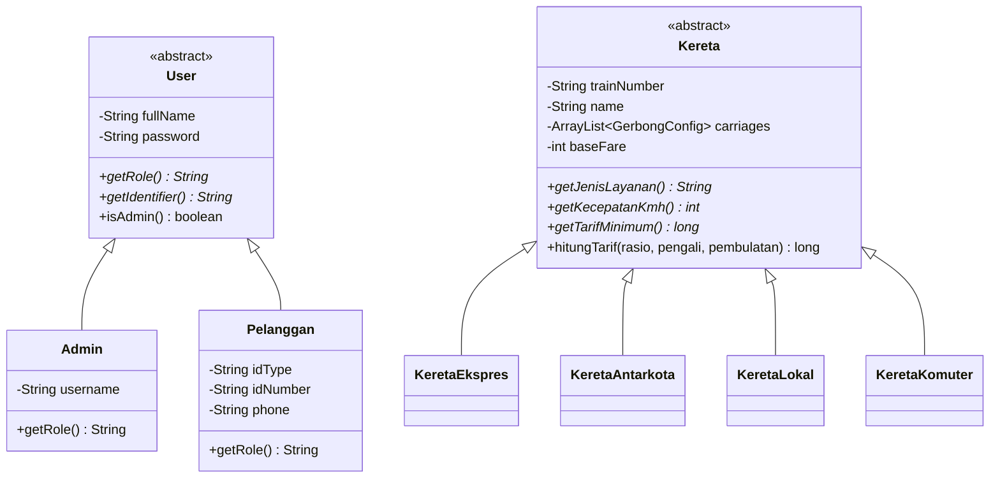

<div align="center">

# 🚆 Sistem Informasi Penjadwalan & Pemesanan Tiket Kereta

**Aplikasi Desktop Java Swing bertema *Access by KAI* — Jalur Kereta Api Madura**


*Tugas Mata Kuliah Pemrograman Berorientasi Objek (PBO) — arsitektur OOP bersih, persistensi JSON berbasis `ArrayList`, UI modern responsif HiDPI, dan kompatibel penuh dengan NetBeans GUI Builder.*

</div>

---

## ✨ Fitur Utama

### 👤 Alur Pelanggan
- **Autentikasi & Registrasi** — Login terpadu (Username / No. Identitas) dan pendaftaran akun pelanggan baru dengan validasi keunikan KTP/NIK atau Paspor.
- **Cari Tiket** — Pilih stasiun asal & tujuan dari 21 stasiun jalur Madura, tombol tukar asal-tujuan, pilih jumlah penumpang (1–4 orang), serta pintasan rute populer.
- **Pilih Kereta** — Menampilkan daftar jadwal yang melewati rute secara berurutan lengkap dengan jenis layanan, kelas, jam berangkat–tiba, sisa kursi per kelas, dan tarif bulat ribuan (`Rp xx.xxx`).
- **Input Penumpang & Denah Kursi Interaktif (`SeatMapPanel`)** — Pengisian data tiap penumpang (dengan tombol isi otomatis dari akun) serta pemilihan gerbong & kursi visual:
  - 🟢 **Hijau** = Kosong &nbsp;|&nbsp; 🔵 **Biru** = Dipilih &nbsp;|&nbsp; ⚪ **Abu-abu** = Terisi
  - Mendukung layout gerbong **50 kursi** (2-2 × 13 baris), **64 kursi** (2-2 × 16), **80 kursi** (2-2 × 20), dan **90 kursi** (3-3 × 15) dengan kode kursi `G{gerbong}-{baris}{huruf}`.
- **Pembayaran & E-Tiket** — Ringkasan pesanan, pembayaran instan (*Bayar Sekarang* → status `Lunas`), dan tampilan **E-Tiket** lengkap berkode booking `TKT-0001`.
- **Tiket Saya** — Riwayat pemesanan pelanggan untuk melihat ulang E-Tiket, melanjutkan pembayaran, atau membatalkan tiket (otomatis melepas kursi).

### 🛠️ Alur Administrator
- **Dashboard Ringkas** — Kartu statistik KPI (*Total Stasiun, Total Kereta, Total Jadwal, Total Pemesanan, Pendapatan Lunas*), tabel transaksi terbaru, dan tombol cepat Backup/Restore JSON.
- **Kelola Stasiun, Kereta, & Jadwal** — CRUD penuh (Tambah, Ubah, Hapus) dengan validasi relasi data yang langsung diperbarui pada `ArrayList` di memori.
- **Kelola Pemesanan** — Filter berdasarkan status (`Semua`, `Dipesan`, `Lunas`, `Dibatalkan`), lihat detail penumpang, tandai lunas, atau batalkan pesanan.
- **Backup & Restore JSON** — Export/Import file `.json` via `JFileChooser` lengkap dengan validasi struktur data (minimal 1 akun `ADMIN` dan daftar stasiun valid) sehingga data lama tetap aman bila import gagal.

---

## 🏗️ Arsitektur PBO

Aplikasi dirancang dengan pemisahan layer yang jelas dan menerapkan pilar utama **Pemrograman Berorientasi Objek**:



| Prinsip PBO | Penerapan di Proyek |
| :--- | :--- |
| **Abstraction & Inheritance** | Abstract class `User` (`Admin`, `Pelanggan`) dan `Kereta` (`KeretaEkspres`, `KeretaAntarkota`, `KeretaLokal`, `KeretaKomuter`). |
| **Polymorphism** | Override `getRole()`, `getIdentifier()`, `getJenisLayanan()`, `getKecepatanKmh()`, `getTarifMinimum()`, dan perhitungan tarif. |
| **Encapsulation** | Seluruh atribut model bersifat `private` dengan akses melalui getter/setter terkontrol. |
| **Custom Exception** | `ValidasiException` menangani error validasi input, aturan bisnis, dan keamanan Restore JSON. |
| **In-Memory DB + JSON** | `DataStore` menyimpan seluruh data operasional secara sementara di `ArrayList` (dimuat awal dari `data/data.json`), dengan fitur **Backup** (export `ArrayList` → JSON) dan **Restore** (import JSON → `ArrayList`) menggunakan pola **DTO + Factory** (`DataDto`, `ModelFactory`, `JsonStorage`). |

> 📘 **Ingin mempelajari cara kerja setiap package, konsep PBO/Swing, dan alur lengkap transaksinya?** Baca [**Panduan Arsitektur & Alur Proyek**](docs/PANDUAN_ARSITEKTUR.md).

---

## 📂 Struktur Proyek

```text
SistemTiketKereta/
├── data/
│   └── data.json                  # Dataset awal (21 stasiun, 10 kereta, 48 jadwal, 3 akun)
├── lib/
│   ├── flatlaf-3.5.4.jar          # Look & Feel modern + dukungan HiDPI UIScale
│   └── gson-2.10.1.jar            # Serialisasi / deserialisasi & Backup-Restore JSON
└── src/tiketkereta/
    ├── model/                     # Entitas & hierarki OOP (User, Kereta, Stasiun, Jadwal, Pemesanan, dll.)
    ├── data/                      # DataStore (ArrayList), DataDto, ModelFactory, JsonStorage
    ├── service/                   # AuthService, JadwalService, PemesananService, TarifService
    ├── ui/                        # MainFrame, Login, Register, CariTiket, PilihKereta, PesanKursi, SeatMapPanel, Pembayaran, ETiket, TiketSaya
    ├── ui/admin/                  # Dashboard, KelolaStasiun, KelolaKereta, KelolaJadwal, KelolaPemesanan, BackupRestore
    └── util/                      # Tema (Access by KAI palette & HiDPI), FormatUtil, ValidasiException
```

---

## 🧮 Aturan Tarif & Dataset Awal

### Rumus Tarif
```text
tarif = base_fare × (|id_tujuan - id_asal| / |id_awal_rute - id_akhir_rute|) × pengali_kelas
```
Hasil dibulatkan ke **kelipatan Rp 1.000 terdekat** (`Math.round(nilai / 1000.0) * 1000`) dengan pengali kelas:
- **Ekonomi**: `1.0×` &nbsp;|&nbsp; **Ekonomi Premium**: `1.2×` &nbsp;|&nbsp; **Bisnis**: `1.4×` &nbsp;|&nbsp; **Eksekutif**: `1.8×`

### Akun Demo Bawaan (`data/data.json`)

| Peran | Username / No. Identitas | Password | Keterangan |
| :--- | :--- | :--- | :--- |
| **Admin** | `admin` | `admin123` | Akses penuh Dashboard, CRUD, & Backup/Restore JSON |
| **Pelanggan (KTP)** | `3529000000000001` | `budi123` | Budi Santoso |
| **Pelanggan (Paspor)** | `A1234567` | `sari123` | Sari Wulandari |

---

## 🚀 Cara Menjalankan

### Prasyarat
- **JDK 1.8 (Java 8)**
- **NetBeans IDE 8.2** *(disarankan untuk membuka tab Design `.form`)*

### 1. Melalui NetBeans IDE 8.2
1. Clone repositori ini:
   ```bash
   git clone https://github.com/rtwone/SistemTiketKereta.git
   ```
2. Buka **NetBeans IDE 8.2** → **File → Open Project...** → pilih folder `SistemTiketKereta`.
3. Klik kanan proyek → **Clean and Build** (`Shift + F11`).
4. Tekan **F6** untuk menjalankan `tiketkereta.ui.MainFrame`.

### 2. Melalui Command Line (Ant / Java)
```bash
# Build dengan Ant
ant clean jar

# Jalankan aplikasi
java -jar dist/SistemTiketKereta.jar
```

---

## 📄 Lisensi

Proyek ini dirilis di bawah lisensi **[MIT License](LICENSE)**.

---

<div align="center">
  <sub>Dibangun dengan ☕ Java 8 Swing & FlatLaf — Jalur Kereta Api Madura</sub>
</div>
