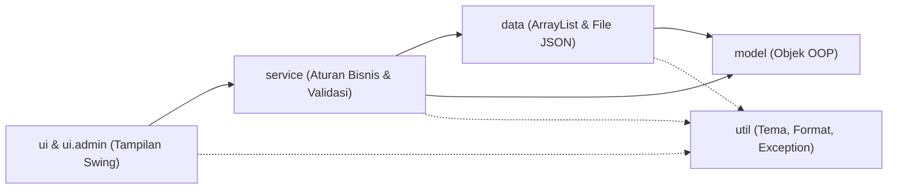
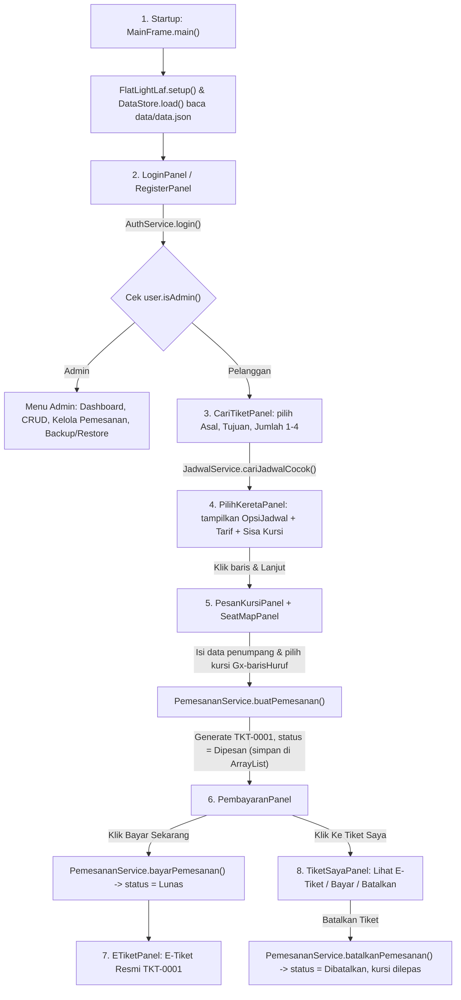

# 📘 Panduan Arsitektur & Alur Proyek SistemTiketKereta

Dokumen ini membedah isi seluruh package pada proyek **SistemTiketKereta**, menjelaskan konsep Java, Swing, dan PBO yang sering membingungkan pemula, serta menggambarkan alur lengkap proses transaksi pemesanan tiket hingga E-Tiket terbit.

---

## 1. Gambaran Besar Arsitektur (5 Layer)

Aplikasi ini dibagi menjadi **5 package** agar setiap file memiliki satu tanggung jawab yang jelas (*Separation of Concerns*):

- **`model`** — cetakan objek dunia nyata (User, Kereta, Stasiun, Jadwal, Pemesanan).
- **`data`** — penyimpanan data di memori (`ArrayList`) dan jembatan baca/tulis ke [`data/data.json`](../data/data.json).
- **`service`** — otak aplikasi (login, hitung tarif, cari jadwal, cek kursi, bayar, batal, CRUD).
- **`ui` & `ui.admin`** — tampilan jendela, tabel, tombol, dan denah kursi.
- **`util`** — alat bantu lintas package (tema warna/font, format Rupiah, custom exception).

---

## 2. Bedah Per Package & Konsep Penting untuk Pemula

### A. Package `tiketkereta.data` (Penyimpanan & JSON)

File: [`DataStore.java`](../src/tiketkereta/data/DataStore.java), [`DataDto.java`](../src/tiketkereta/data/DataDto.java), [`ModelFactory.java`](../src/tiketkereta/data/ModelFactory.java), [`JsonStorage.java`](../src/tiketkereta/data/JsonStorage.java).

1. **Kenapa memakai `DataDto` + `ModelFactory`? Kenapa Gson tidak langsung membaca ke `ArrayList<Kereta>` atau `ArrayList<User>`?**
   - `Kereta` dan `User` adalah **`abstract class`** (tidak bisa diinstansiasi langsung dengan `new Kereta()` atau `new User()`).
   - Saat Gson membaca JSON, Gson tidak otomatis tahu apakah sebuah objek JSON harus dibuat sebagai `Admin` atau `Pelanggan`, atau `KeretaEkspres` vs `KeretaKomuter`.
   - **Solusinya (pola DTO + Factory)**:
     - **DTO (*Data Transfer Object*)** di [`DataDto.java`](../src/tiketkereta/data/DataDto.java) adalah class polos sementara yang bentuk field-nya 100% mengikuti struktur `data.json`.
     - **`@SerializedName("base_fare")`** memberi tahu Gson bahwa key JSON `base_fare` (*snake_case*) dipetakan ke variabel Java `baseFare` (*camelCase*).
     - **`ModelFactory`** di [`ModelFactory.java`](../src/tiketkereta/data/ModelFactory.java) membaca `dto.serviceType` / `dto.role` lalu membuat subclass konkret (`new KeretaEkspres(...)`, `new Admin(...)`, dll.), serta mengonversi balik ke DTO saat menyimpan ke JSON.
2. **Bagaimana cara kerja `DataStore` (`ArrayList` sementara + Backup/Restore JSON)?**
   - Saat aplikasi dimulai, `DataStore.load()` memuat data awal dari `data/data.json` ke dalam 5 `ArrayList` di memori RAM (`stasiunList`, `keretaList`, `jadwalList`, `userList`, `pemesananList`).
   - Selama aplikasi berjalan, seluruh perubahan (registrasi, pemesanan, pembayaran, pembatalan, CRUD admin) **hanya disimpan sementara di `ArrayList`** (tidak auto-save menimpa `data/data.json`).
   - Jika ingin menyimpan hasil perubahan ke file, Admin menggunakan **Backup JSON** (`backupToFile`) untuk meng-export isi `ArrayList` ke file `.json`, dan **Restore JSON** (`restoreFromFile`) untuk memuat ulang file `.json` ke dalam `ArrayList` sistem.
3. **Kenapa Restore JSON memakai list sementara (`stasiunBaru`, `keretaBaru`, dst.) sebelum `.clear()`?**
   - Di [`JsonStorage.java`](../src/tiketkereta/data/JsonStorage.java) dan [`DataStore.java`](../src/tiketkereta/data/DataStore.java), file JSON divalidasi terlebih dahulu (JSON valid, minimal 1 akun `ADMIN`, daftar stasiun tidak kosong). Jika gagal, `ValidasiException` dilempar **sebelum** data lama dihapus sehingga data aktif tetap aman.

---

### B. Package `tiketkereta.model` (Blueprint PBO)

File utama: [`User.java`](../src/tiketkereta/model/User.java), [`Admin.java`](../src/tiketkereta/model/Admin.java), [`Pelanggan.java`](../src/tiketkereta/model/Pelanggan.java), [`Kereta.java`](../src/tiketkereta/model/Kereta.java) (+ 4 subclass), [`Stasiun.java`](../src/tiketkereta/model/Stasiun.java), [`Jadwal.java`](../src/tiketkereta/model/Jadwal.java), [`Pemesanan.java`](../src/tiketkereta/model/Pemesanan.java), [`OpsiJadwal.java`](../src/tiketkereta/model/OpsiJadwal.java).

1. **`abstract class` vs class biasa**:
   - `User` dan `Kereta` dibuat `abstract` karena tidak ada pengguna tanpa peran atau kereta tanpa jenis layanan. Method `abstract` seperti `getRole()` dan `getJenisLayanan()` memaksa semua subclass mengimplementasikannya.
2. **Polimorfisme & *Dynamic Dispatch***:
   - Di `DataStore`, `Admin` dan `Pelanggan` disimpan bersama dalam satu `ArrayList<User>`.
   - Saat login di [`AuthService.java`](../src/tiketkereta/service/AuthService.java), cukup memanggil `user.getIdentifier()`: jika objeknya `Admin` maka yang dicek adalah `username`; jika `Pelanggan` maka yang dicek adalah `idNumber` (KTP/Paspor).
   - Di `Kereta.hitungTarif(...)`, method induk memanggil `getTarifMinimum()`, dan Java otomatis memakai tarif minimum milik subclass masing-masing (`KeretaEkspres` Rp 25.000, `KeretaAntarkota` Rp 10.000, `KeretaLokal` Rp 5.000, `KeretaKomuter` Rp 3.000).
3. **Fungsi [`OpsiJadwal.java`](../src/tiketkereta/model/OpsiJadwal.java)**:
   - Satu `Jadwal` kereta bisa memiliki beberapa kelas (misalnya KA Jokotole memiliki **Eksekutif** dan **Bisnis** dengan tarif serta sisa kursi berbeda).
   - `OpsiJadwal` membungkus 1 kombinasi `Jadwal` + `Kereta` + 1 `kelas` + jam berangkat–tiba + sisa kursi + tarif sehingga **1 objek `OpsiJadwal` = 1 baris di tabel Pilih Kereta**.

---

### C. Package `tiketkereta.service` (Logika Bisnis)

File: [`AuthService.java`](../src/tiketkereta/service/AuthService.java), [`JadwalService.java`](../src/tiketkereta/service/JadwalService.java), [`TarifService.java`](../src/tiketkereta/service/TarifService.java), [`PemesananService.java`](../src/tiketkereta/service/PemesananService.java).

1. **Pencarian rute searah di [`JadwalService.java`](../src/tiketkereta/service/JadwalService.java)**:
   - Setiap jadwal menyimpan daftar pemberhentian (`stops`) berurutan, misalnya `SMP → PMK → SPG → BGA → BKL → KML`.
   - Pencarian mengambil indeks stasiun asal (`idxAsal`) dan tujuan (`idxTujuan`). Jadwal cocok hanya bila `idxAsal >= 0` **dan** `idxTujuan > idxAsal` (memastikan arah perjalanan tidak terbalik).
   - Hasil diurutkan naik berdasarkan jam berangkat dengan `Collections.sort(..., new Comparator<OpsiJadwal>() { ... })`.
2. **`Set<String>` (`HashSet`) untuk pengecekan kursi di [`PemesananService.java`](../src/tiketkereta/service/PemesananService.java)**:
   - `Set` tidak menyimpan duplikat dan sangat cepat untuk mengecek `.contains("G1-2A")`.
   - `getKursiTerisi(scheduleId)` mengumpulkan semua kursi dari pesanan yang berstatus `Dipesan` atau `Lunas` (`isKursiAktif()`). Jika tiket dibatalkan (`Dibatalkan`), kursinya otomatis keluar dari `Set` dan bisa langsung dipesan ulang.
3. **Pemisahan error dengan `throws ValidasiException`**:
   - Layer `service` tidak memanggil `JOptionPane` secara langsung; ia cukup melempar `throw new ValidasiException("pesan")` agar layer `ui` yang menangkapnya dengan `try-catch` dan menampilkannya ke pengguna.

---

### D. Package `tiketkereta.ui` & `tiketkereta.ui.admin` (Tampilan Swing)

File utama: [`MainFrame.java`](../src/tiketkereta/ui/MainFrame.java), [`SeatMapPanel.java`](../src/tiketkereta/ui/SeatMapPanel.java), dan 14 pasangan `.java` + `.form`.

1. **Satu Jendela dengan `CardLayout` di [`MainFrame.java`](../src/tiketkereta/ui/MainFrame.java)**:
   - Menggunakan satu `JFrame` dengan 2 tingkat `CardLayout`:
     - Tingkat luar (`pnlRoot`): berganti antara layar `"AUTH"` (Login/Register tanpa sidebar) dan `"APP"` (Sidebar + area konten).
     - Tingkat dalam (`pnlContent`): berganti antar semua layar Pelanggan dan Admin tanpa membuka jendela baru.
2. **Dua Constructor pada setiap `JPanel` (`LoginPanel()` dan `LoginPanel(MainFrame)`)**:
   - Constructor tanpa parameter menjaga kompatibilitas dengan tab **Design** NetBeans GUI Builder.
   - Constructor dengan parameter `MainFrame` dipakai saat runtime untuk mengakses service dan navigasi antar layar.
3. ***Callback Interface* (`SeatSelectionListener`) di [`SeatMapPanel.java`](../src/tiketkereta/ui/SeatMapPanel.java)**:
   - `SeatMapPanel` mendefinisikan `interface SeatSelectionListener { void onSelectionChanged(Set<String> selectedSeats); }`.
   - `PesanKursiPanel` mendaftarkan listener tersebut sehingga setiap klik tombol kursi di `SeatMapPanel` otomatis memperbarui ringkasan kursi terpilih di `PesanKursiPanel`.
   - Kursi terpilih disimpan dalam `LinkedHashSet<String>` agar unik sekaligus mempertahankan urutan klik penumpang.
4. **Pasangan `.java` + `.form` dan blok `GEN`**:
   - File `.form` menyimpan struktur layout XML NetBeans 8.2 (hanya `BorderLayout`, `GridLayout`, `FlowLayout`, `CardLayout` — tanpa `GroupLayout`).
   - Semua styling FlatLaf, listener, dan pengisian data diletakkan di method terpisah (`setupStyle()`, `setupEvents()`, `refreshData()`) di luar blok `//GEN-BEGIN:initComponents`.

---

### E. Package `tiketkereta.util` (Alat Bantu)

File: [`Tema.java`](../src/tiketkereta/util/Tema.java), [`FormatUtil.java`](../src/tiketkereta/util/FormatUtil.java), [`ValidasiException.java`](../src/tiketkereta/util/ValidasiException.java).

1. **Constructor `private` pada `Tema` & `FormatUtil`**:
   - Seluruh method-nya bersifat `static` sehingga class tidak perlu dibuat objeknya dengan `new`.
2. **FlatLaf & Dukungan HiDPI (`UIScale.scale(...)`)**:
   - `FlatLightLaf.setup()` memberikan tampilan modern dan `FlatClientProperties` menambahkan sudut membulat (`arc`) serta `PLACEHOLDER_TEXT`.
   - Karena Java 8 tidak otomatis menskalakan font/ukuran kustom pada layar beresolusi tinggi (misal 2K/175% Windows scaling), `Tema.s(px)` menggunakan `UIScale.scale(px)` agar UI tetap besar, tajam, dan proporsional di layar 1080p maupun 2.8K.
3. **`DefaultTableCellRenderer` Kustom**:
   - `Tema.createStatusRenderer()` memberi warna teks otomatis pada kolom status di `JTable`: Hijau (`Lunas`), Amber (`Dipesan`), dan Merah (`Dibatalkan`).

---

## 3. Alur Lengkap Proses Transaksi Pemesanan Tiket

### Ringkasan Langkah Transaksi:
1. **Startup (`MainFrame.main`)** — FlatLaf aktif, lalu `DataStore.load()` memuat `data/data.json` lewat `JsonStorage` → `DataDto` → `ModelFactory` ke dalam 5 `ArrayList`.
2. **Autentikasi (`LoginPanel` → `AuthService`)** — Memvalidasi akun lewat `user.getIdentifier()`, menyimpan user aktif, lalu membentuk sidebar sesuai role (`Admin` atau `Pelanggan`).
3. **Pencarian Jadwal (`CariTiketPanel` → `JadwalService` + `TarifService` + `PemesananService`)** — Menyaring jadwal searah, menghitung sisa kursi per kelas dan tarif bulat ribuan, lalu menampilkan daftar `OpsiJadwal`.
4. **Input Penumpang & Pilih Kursi (`PesanKursiPanel` + `SeatMapPanel`)** — Membuat 1–4 form penumpang dinamis, mengambil daftar kursi terisi pada trip tersebut, dan merender denah kursi per gerbong (`G1-1A`, `G2-7C`, dst.).
5. **Pembuatan Pesanan (`PemesananService.buatPemesanan`)** — Validasi input penumpang dan anti *double booking*, menerbitkan kode booking (`TKT-0001`, dst.), lalu menyimpan pesanan berstatus **`Dipesan`** ke `ArrayList` di memori.
6. **Pembayaran & E-Tiket (`PembayaranPanel` → `ETiketPanel`)** — Klik **Bayar Sekarang** mengubah status menjadi **`Lunas`** di memori dan langsung menampilkan E-Tiket resmi.
7. **Pembatalan, Kelola Admin, & Backup/Restore** — Pembatalan mengubah status menjadi **`Dibatalkan`** sehingga kursi otomatis tersedia kembali. Untuk menyimpan seluruh data sementara `ArrayList` ke file atau memuat data cadangan ke sistem, Admin dapat memakai menu **Backup & Restore JSON**.
